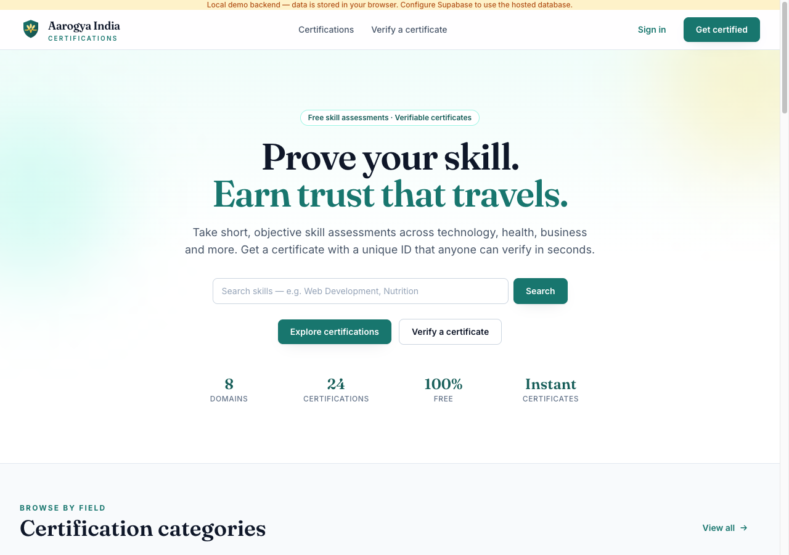

# Aarogya India — Skill Assessment & Certification Platform

An original, production-shaped certification platform built for **Aarogya India**: browse skill
certifications, take timed objective assessments, get server-scored results, earn a verifiable
digital certificate with a QR code, and verify any certificate publicly.

> **Original work.** The product, brand, palette, copy, components and assets are original. A
> public reference site (certificates.eventbeep.com) was studied **passively with REA** only for
> functional/UX inspiration — no code, assets, logos or copy were copied. See
> [docs/01-reference-analysis.md](docs/01-reference-analysis.md).



---

## Features

**Candidate**
- Homepage: hero, search, category cards, featured certifications, how-it-works, benefits,
  certificate steps, FAQ, CTAs.
- Directory: keyword search, domain filters, sorting (popular / newest / A–Z), shareable URLs.
- Certification landing pages: description, eligibility, topics, assessment details, start CTA.
- Timed assessment: candidate details, rules acknowledgement, countdown, question navigator,
  answer/change, mark-for-review, progress, confirm-before-submit, auto-submit at zero.
- Results: score ring, percentage, level, pass/fail, topic breakdown, strengths, improvements,
  recommendations, certificate eligibility.
- Certificate: premium template, holder name, title, unique ID, issue date, score, issuer,
  QR code, PDF download, public share links.
- Dashboard: profile, stats, in-progress, completed, results, certificates, history.

**Public**
- Verification page (`/verify`) and QR destination (`/verify/:certificateId`): valid, revoked,
  expired and not-recognized states — no login required.

**Admin**
- Analytics overview (candidates, attempts, certificates, pass rate, per-domain).
- Manage domains, create certifications, add questions to banks, review attempts, revoke
  certificates.

## Stack

- React 18 + TypeScript + Vite, React Router, Tailwind CSS
- `@react-pdf/renderer` (PDF certificate), `qrcode` (QR)
- Data layer: **Supabase** (Auth + Postgres + RLS + RPC) or **Local** (self-contained browser
  backend used for the demo) behind one `DataProvider` interface
- Tests: Vitest + Testing Library (unit/integration) and Puppeteer e2e journeys

## Quick start

```bash
cd app
npm install
npm run dev          # http://localhost:5173
```

Local demo backend (default): data persists in `localStorage`, seeded with 8 domains,
24 certifications and question banks.

Demo accounts:
- **Admin:** `admin@aarogya.in` / `Admin@12345`
- **Candidate:** register any email from the UI.

## Testing

```bash
cd app
npm run test         # 13 unit/integration tests
npm run e2e          # 19 browser acceptance checks (needs dev server + Chrome on :9222)
```

E2E connects to an already-running Chrome with `--remote-debugging-port=9222`:

```bash
"/Applications/Google Chrome.app/Contents/MacOS/Google Chrome" \
  --remote-debugging-port=9222 --user-data-dir=/tmp/ac-chrome "http://localhost:5173"
```

Latest run: **13/13 unit tests**, **19/19 e2e checks** covering acceptance journeys 1–12.
Screenshots: [app/docs/screenshots](app/docs/screenshots).

## Supabase mode

1. Create a Supabase project.
2. Run [`supabase/migrations/0001_init.sql`](supabase/migrations/0001_init.sql) in the SQL editor
   (tables, indexes, RLS policies, and RPCs: `start_attempt`, `get_attempt_questions`,
   `save_answer`, `toggle_mark_for_review`, `submit_attempt`, `verify_certificate`,
   `revoke_certificate`, `admin_analytics`).
3. Sign up your admin user, then:
   ```sql
   update profiles set role = 'admin' where id = '<auth-user-uuid>';
   ```
4. Create `app/.env.local`:
   ```
   VITE_DATA_BACKEND=supabase
   VITE_SUPABASE_URL=https://<project>.supabase.co
   VITE_SUPABASE_ANON_KEY=<anon-key>
   ```

The same UI then runs against Supabase Auth/Postgres with all scoring and issuance server-side.

## Security & integrity

- Correct answers are **never** sent to the client before submission (`get_attempt_questions`
  strips `is_correct`; the local adapter does the same).
- Scoring is computed server-side (Supabase RPC; local scoring is performed inside the provider,
  not by UI code). Submissions are idempotent — duplicate submits cannot double-issue.
- Certificate IDs are random, non-sequential and unique (`AIC-XXXX-XXXX-XXXX`), enforced by a
  unique index plus a generation loop.
- Issuance only happens from a passed, completed attempt; one certificate per attempt.
- Revocation is immediate for public verification.
- RLS: candidates read only their own attempts/results/certificates; catalog is public-read;
  admin writes require `role = 'admin'`; verification uses a security-definer RPC returning only
  display-safe fields.
- PDF/QR are generated client-side from the stored certificate record; the certificate page is
  owner/admin-only while verification stays public.

## Honest capability register

| Capability | Status |
|---|---|
| Objective scoring | **Real** — deterministic, rule-based |
| AI evaluation | **Not implemented** — not claimed anywhere in the UI |
| Auth / DB / RLS | **Real** in Supabase mode; local mode is a clearly-labelled browser mock |
| Certificate issuance | Real in whichever backend is active |
| PDF + QR | Real (client-side generation) |
| Payments | Out of scope (all assessments free) |
| Email delivery | Not implemented |

## Project layout

```
aarogya-certify/
├── app/                       # React app
│   ├── src/
│   │   ├── brand/             # original logo/mark
│   │   ├── components/        # layout, cards, UI primitives, certificate preview
│   │   ├── context/           # auth context
│   │   ├── data/              # DataProvider interface, local & Supabase adapters, seed
│   │   ├── modules/certificate# QR + PDF generation
│   │   ├── pages/             # home, directory, detail, assessment, results, verify, admin…
│   │   └── test/              # vitest setup + provider tests
│   ├── scripts/e2e.mjs        # browser acceptance journeys
│   └── docs/screenshots/      # captured evidence
├── supabase/migrations/       # PostgreSQL schema, RLS, RPCs
└── docs/                      # reference analysis + design/architecture + acceptance report
```
