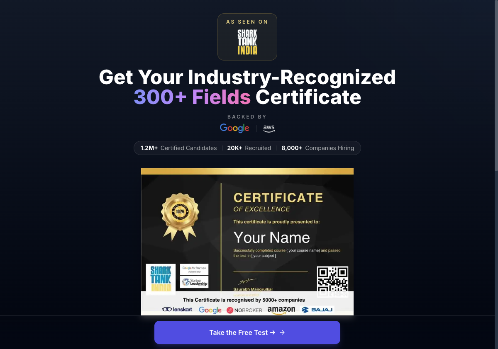

# Reference Analysis — certificates.eventbeep.com (REA passive observation)

> Collected via REA CDP browser observation (passive; no code/assets copied). Used only as a
> **functional & UX reference**. Aarogya India's implementation is original — different brand,
> palette, layout, copy, components, and code.

## 1. Site identity & tech
- Title: "300+ Fields Certification Online | Beep". React SPA (Vite-style `/assets/*.js` chunks).
- Chunk names reveal feature modules: `GetCertificate`, `Verification`, `CertificateCard`,
  `QuestionPage`, `GamifiedQuestionPage`, `OnboardingFlow`, `LeavePagePrompt`,
  `ExitIntentRecapture`, `domainConfig` (large domain catalog), `Nav`, `orderStatus`, `intern-api`.
- Marketing proof: "As seen on Shark Tank India", "Backed by Google / AWS", stats
  "1.2M+ certified · 20K+ recruited · 8,000+ companies hiring".

## 2. Public routes observed
| Route | Purpose |
|---|---|
| `/` | Hero + certificate preview + CTA "Take the Free Test" |
| `/get-certificate` | Directory + multi-step assessment start (domain select → details → assessment → certificate) |
| `/get-certificate?domain=<slug>` | Deep link to a pre-selected domain |
| `/verify` | Public certificate verification by ID |
| `/pricing`, `/refund-policy`, `/terms`, `/privacy`, `/contact` | Standard footer/legal |

## 3. Homepage (observed)
- Dark navy hero, centered. "AS SEEN ON" badge, big headline "Get Your Industry-Recognized
  300+ Fields Certificate" (gradient accent on "300+ Fields").
- "BACKED BY" logos row; stat pill (certified / recruited / hiring).
- Large sample certificate image (gold seal, "CERTIFICATE OF EXCELLENCE", recipient name,
  course/subject, signature, QR code bottom-right, "recognised by 5000+ companies" + logos).
- Primary CTA button "Take the Free Test →".

## 4. Directory / assessment-start (`/get-certificate`) — observed
- Step header: "1 Select your domain", progress "17% Complete", stepper
  `Domain & Details → Assessment → Certificate`.
- Heading "Which skill should we certify you in?" with "~7 min · 1L+ certified".
- Search textbox "Search for a domain...".
- Category tab list (horizontal scroll): All, Healthcare & Hospital, Electrician/Solar/Repair,
  Tech/Data & AI, Business & Management, Finance/Banking & Tax, Marketing/Media & Design,
  HR/Legal & Office, Engineering/Construction & Safety, Automobile & EV, Nutrition/Yoga & Fitness,
  Beauty & Events, Teaching & Education, Hotel/Food & Travel, Agriculture & Dairy.
- Grid of selectable certification cards (radio + title + one-line description). Selected card
  highlighted with "Selected" badge.
- Sticky bottom CTA "Continue with <domain> →".
- Dozens of skills observed: Corporate Lawyer, Lean Six Sigma (MBB/BB), Sales, HR, AI,
  Cyber Security, Digital Marketing, Finance, Data Analytics, Administrative Mgmt, Legal Drafting,
  Public Health & Community Nutrition, GST Practitioner, Project Mgmt, Stock Marketing,
  Operations Mgmt, Interior Design, Business Analytics, Sports & Performance Nutrition,
  People Mgmt, UI/UX, HR Recruiter, Certified Accountant, VLSI, Data Science, Python, Cloud,
  Admission Counselor, Income Tax Practitioner, Food Science & Safety, Web Development,
  Team Mgmt, Architecture, Diet Planning, Clinical Dietitian, Nano Technology, Genetic Engineering…

## 5. Verification (`/verify`) — observed
- Simple centered card: heading "Verify Certificate", subtext "Enter your certificate ID to
  verify its authenticity", single textbox "Enter Certificate ID", button "Verify Certificate".
- Verification is public (no login). QR on certificate points here.

## 6. Inferred user journeys (functional reference)
1. **Discover** → home hero → CTA → directory.
2. **Choose** → search/filter category → select skill card → continue.
3. **Onboard** → candidate details form (OnboardingFlow) → instructions/rules.
4. **Assess** → timed MCQ (QuestionPage / GamifiedQuestionPage), ~7 min, leave-page prompt.
5. **Result** → score analysis → eligible → certificate with unique ID + QR.
6. **Verify** → anyone opens `/verify`, enters ID → valid/invalid state.

## 7. What we adopt vs. differentiate
| Adopt (functional idea) | Differentiate (Aarogya India original) |
|---|---|
| Multi-domain catalog + search + category filter | Own domain set, card design, copy |
| Stepper: details → assessment → certificate | Own stepper styling & labels |
| Timed MCQ with progress | Own assessment UI, palette, layout |
| Certificate with unique ID + QR + public verify | Own certificate template, ID scheme, brand |
| Public verification by ID | Own verify page + result presentation |
| Score analysis | Own skill-breakdown presentation |

**Not copied:** Beep name/logo, Shark Tank / Google / AWS / company logos, gold-seal certificate
artwork, dark-navy hero, exact copy text, any JS/CSS.
